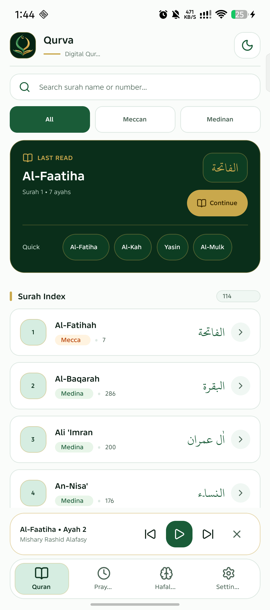
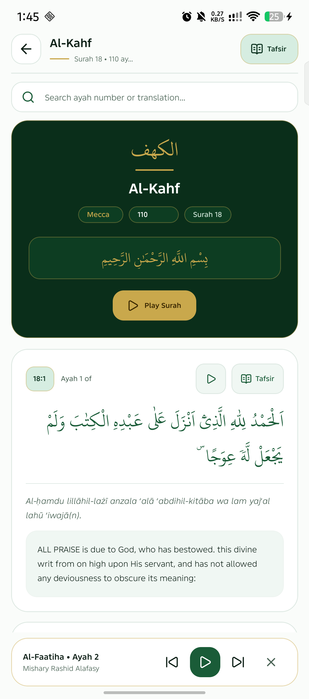
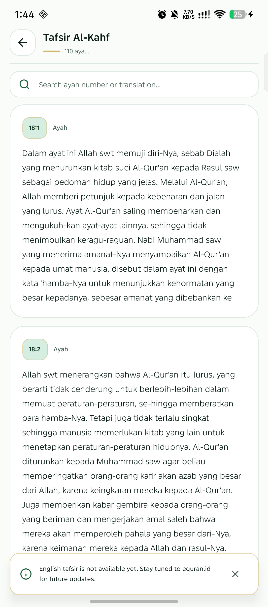
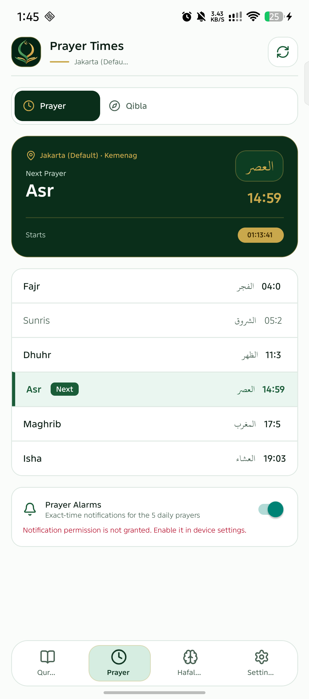
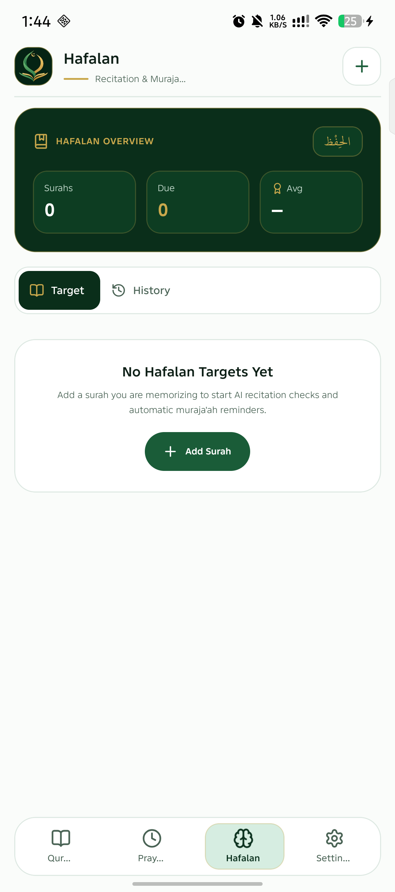
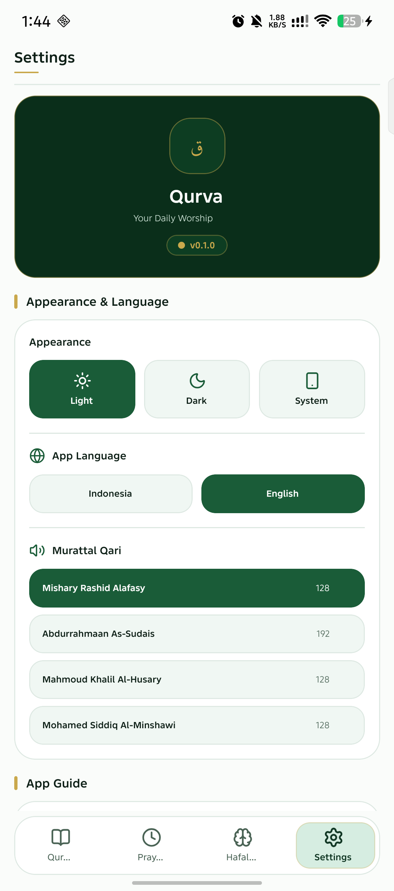

<div align="center">


# Qurva

**Baca Al-Qur'an, dengarkan murattal, jaga waktu shalat, dan murajaah hafalan, dalam satu aplikasi.**

Quran reader · Murattal audio · Prayer times · Qibla · AI-assisted hafalan


</div>

> **Qurva RN** is the React Native + Expo port of the Qurva app. It is a focused slice of the
> original Flutter app, not a feature-for-feature copy.

---

## Showcase

<table>
  <tr>
    <td align="center" width="33%"><br /><b>Surah list</b><br /><sub>Continue reading, offline</sub></td>
    <td align="center" width="33%"><br /><b>Reader</b><br /><sub>Arabic, transliteration, translation</sub></td>
    <td align="center" width="33%"><br /><b>Tafsir</b><br /><sub>Ayah-by-ayah commentary</sub></td>
  </tr>
  <tr>
    <td align="center"><br /><b>Prayer times</b><br /><sub>Computed on-device, with alarms</sub></td>
    <td align="center"><br /><b>Qibla compass</b><br /><sub>Smooth, declination-aware</sub></td>
    <td align="center"><br /><b>Hafalan</b><br /><sub>Record, AI scoring, reminders</sub></td>
  </tr>
  <tr>
    <td align="center"><br /><b>Settings</b><br /><sub>Theme, language, qari</sub></td>
    <td></td>
    <td></td>
  </tr>
</table>

## Features

### 📖 Quran reader

- All 114 surahs with Arabic text (KFGQPC Uthmanic Hafs), transliteration, and translation.
- **Indonesian or English** translation, switchable at any time.
- **Tafsir** per ayah, opened from the reader.
- Search inside a surah by ayah number or translation, with a "continue reading" card for your last position.
- **Offline-first**: content is cached in SQLite after the first load.

### 🎧 Murattal audio

- Play a whole surah or a single ayah, with previous/next controls in a floating mini player.
- Keeps playing in the background and on the **lock screen**.
- Choose your preferred qari in Settings.
- Clear notice when you are offline instead of a silent failure.

### 🕌 Prayer times and alarms

- Prayer times calculated **on-device** from your location, so they work without a connection.
- Countdown hero card for the next prayer.
- Per-prayer **alarms** that ring even with the screen off (Android exact alarms).

### 🧭 Qibla compass

- Live compass dial with a smoothed needle that never spins the long way round.
- Corrects for magnetic declination, and tells you honestly when the sensor is missing.
- "Aligned" feedback when you face the Kaaba.

### 🧠 Hafalan (memorisation)

- Pick surah and ayah range as a target and track its status.
- **Record your setoran**; an AI service transcribes it and scores it against the target text.
- Spaced **muraja'ah reminders** (1, 3, 7, 30, 90 days) scheduled automatically.
- History and progress stats.

### 🎨 Experience

- Forest-green and gold design language with **light, dark, and system** themes.
- Fluid floating tab bar and a 4-slide onboarding you can replay from Settings.
- Fully localised in **Bahasa Indonesia** and **English**.
- Accessible: labelled controls and 44 pt touch targets.

## Get started

```bash
bun install
bunx expo prebuild   # only after native plugin changes
bun run android      # or: bun run ios
```

More in [docs/development.md](docs/development.md).

## Documentation

| Doc | What it covers |
|---|---|
| [docs/features.md](docs/features.md) | What each feature does and how it behaves |
| [docs/architecture.md](docs/architecture.md) | Layers, folders, state, data flow |
| [docs/development.md](docs/development.md) | Setup, commands, testing, conventions |
| [docs/release.md](docs/release.md) | Signed APK/AAB release pipeline |
| [design.md](design.md) | Scope, stack, data contract, decisions |
| [server/README.md](server/README.md) | Hafalan scoring API (FastAPI) |
| [AGENTS.md](AGENTS.md) | Coding rules for AI agents |

## Credits

Quran text, tafsir, and translations from [equran.id](https://equran.id). English translation by
Muhammad Asad via alquran.cloud. Murattal audio from [islamic.network](https://islamic.network).
